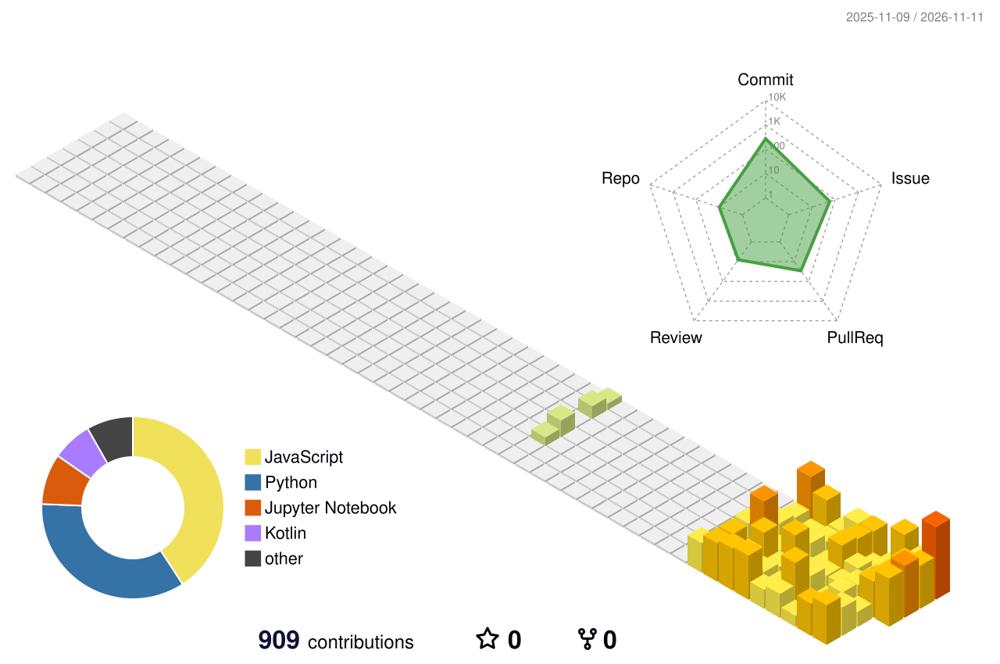

         

 

<picture>
  <source media="(prefers-color-scheme: dark)" srcset="https://raw.githubusercontent.com/Nonmaju/Nonmaju/main/profile-3d-contrib/profile-night-rainbow.svg" />
  
</picture>

 
